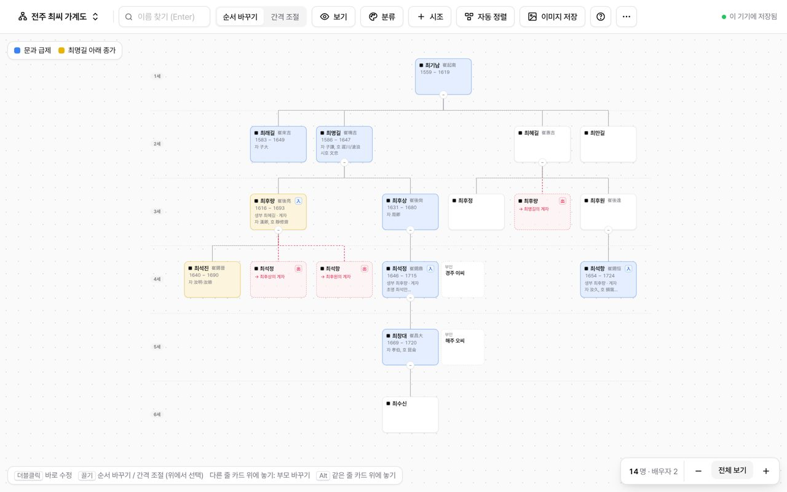
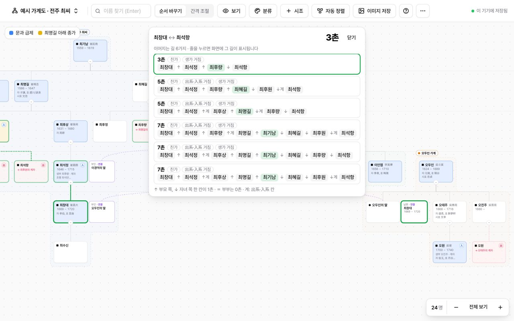
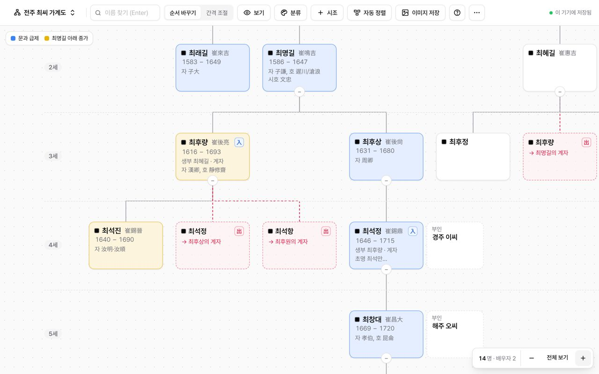

# 가계도 편집기

족보와 가계도를 브라우저에서 그리는 웹 편집기입니다. 설치나 가입 없이 열어서 바로 쓰고, 카드를 끌거나 더블클릭해서 사람을 더해 갑니다.

**👉 https://gagyedo.j-segrc.workers.dev/**



## 왜 만들었나

일반 가계도 프로그램은 서양식 가족 관계에 맞춰져 있어서 우리 족보를 옮기기가 불편합니다. 出系·入系(양자), 딸을 사위 이름으로 적는 방식, 세(世) 번호, 자·호, 여러 집안이 혼인으로 얽힌 관계 같은 것들이 그렇습니다. 이것들을 그대로 적고, 보고, 족보 모양으로 뽑을 수 있게 만들었습니다.

## 할 수 있는 것

**그리기**
- 카드로 사람을 더하고 끌어서 순서를 바꿉니다. 세 번호와 자리는 자동으로 맞춰집니다.
- 出系·入系(양자): 생가와 양가 양쪽에 표시되고, 생가 쪽에는 `出` 칸이 남습니다.
- 딸은 `女 + 남편 이름`으로 적고, 혼인한 집안이 같은 판에 있으면 두 가계를 잇습니다.
- 한 판에 여러 가계를 함께 두고 가계 이름표, 가계 영역, 가계별 선 색으로 구분합니다.
- 접기와 숨기기로 필요한 갈래만 남겨 봅니다.

**보기**
- **촌수 세기**: 두 사람을 고르면 이어지는 길을 모두 찾아 강조합니다. 외가와 처가, 생질과 외손도 셈하고, 혼인 한 번을 사이에 둔 관계는 `사돈`으로 보여 줍니다.
- **혼인 중심 보기**: 혼인 하나를 가운데 두고 남편 쪽 가계는 왼편, 부인 쪽 가계는 오른편에 다시 세웁니다.
- **팔고조도**: 한 사람에서 고조부모까지 아버지 쪽과 어머니 쪽으로 올라가 봅니다. 빈칸(미상)을 눌러 바로 채울 수 있습니다.
- **같은 사람 찾기**: 다른 가계에 따로 적힌 같은 인물(‘○○○의 딸’, ‘○○○의 처’ 등)을 근거와 함께 찾아 잇거나 합칩니다.

| 촌수 세기 | 出系·入系 |
| --- | --- |
|  |  |

**내보내기**
- **이미지(PNG)**: 범위, 가로·세로 방향, 카드 모양을 고를 수 있고, 흑백 인쇄용 표시도 있습니다.
- **족보 형식(PDF)**: 세로쓰기로 한 면에 여러 대(4~7단)씩 A4 쪽으로 짭니다. 장자부터 오른쪽에서 왼쪽으로 놓고, 쪽이 넘어가면 `○見`으로 이어지는 쪽을 적습니다. 쪽 번호는 제본을 생각해 홀수 쪽과 짝수 쪽에서 좌우를 번갈아 둡니다.
- CSV(엑셀) 불러오기·내보내기, JSON 백업, 짧은 링크로 보내기.


**저장**
- 가계도는 기본적으로 쓰는 사람의 브라우저 안(IndexedDB)에만 저장됩니다.
- 동기화 코드를 만들면 다른 기기에서도 같은 판들을 봅니다. 서버에는 판마다 이전 버전 20개를 보관합니다.
- 앱으로 설치할 수 있고, 설치한 뒤에는 인터넷 없이도 열립니다.

## 만든 방식

- **프레임워크나 라이브러리 없이** HTML 파일 하나(`site/index.html`)에 화면과 기능이 모두 들어 있습니다.
- 가계도 배치는 자손 묶음의 윤곽을 비교해 겹치지 않게 붙이는 방식으로 직접 계산합니다.
- 족보 쪽 나눔은 세로 띠 단위로 자르되, 조금 넘치는 사람은 이름째 다음 쪽으로 보내고 긴 설명은 줄 단위로 이어 씁니다.
- PDF는 외부 라이브러리 없이 쪽 그림(JPEG)을 담아 직접 만듭니다.
- 서버는 Cloudflare Workers 두 개입니다. 공유 링크는 KV, 동기화는 D1(SQLite)을 씁니다. 오프라인 사용은 서비스 워커로 합니다.

## 폴더

```
site/        웹 사이트 그대로 (Cloudflare에 이 폴더를 올림)
  index.html   앱 전체
  about.html   검색용 소개 페이지
  sw.js        오프라인 캐시 (새로 올릴 때 VERSION 숫자를 올릴 것)
workers/
  share.js     짧은 공유 링크 서버 (KV: SHARES)
  sync.js      기기 간 동기화 서버 (D1: DB)
docs/
  setup.md     배포 방법, 서버 설정, 관리자용 SQL
  images/      README 그림
```

내 컴퓨터에서 열어 보려면 `site/` 폴더에서 `python -m http.server 8000`을 실행하고 http://localhost:8000 으로 들어가면 됩니다.

## 만든 사람

세
